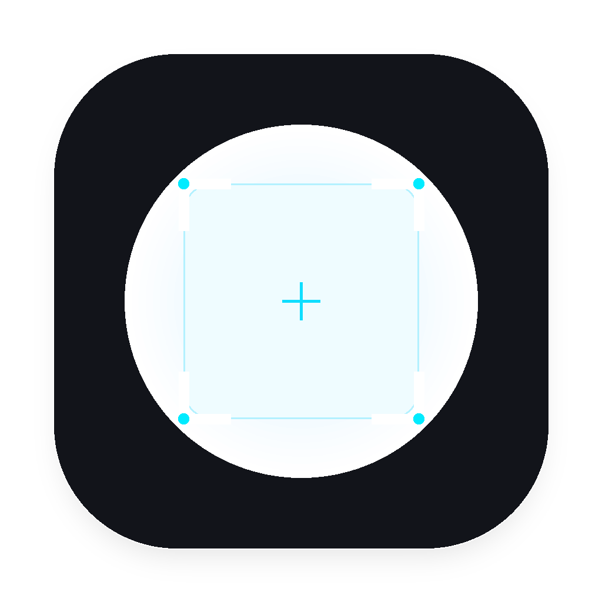
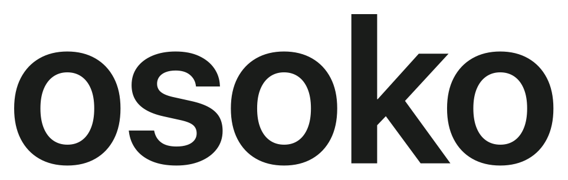
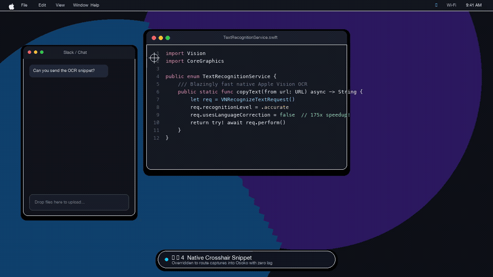
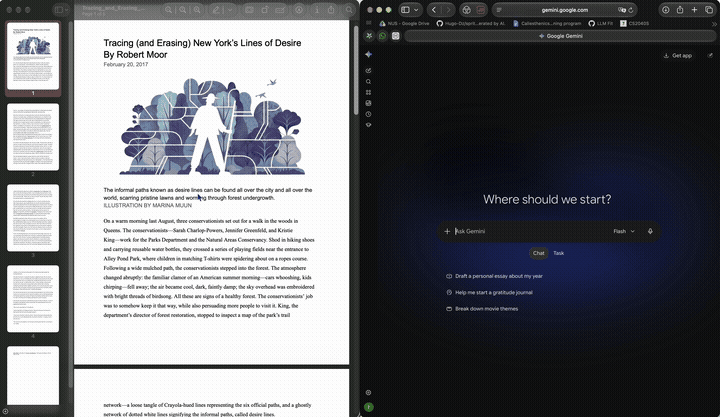
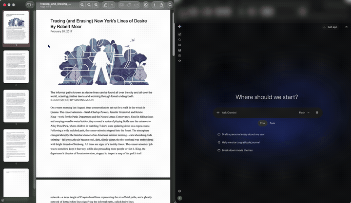
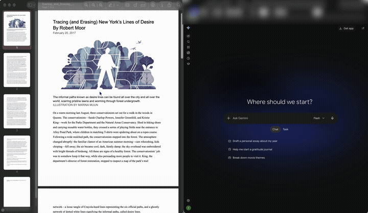
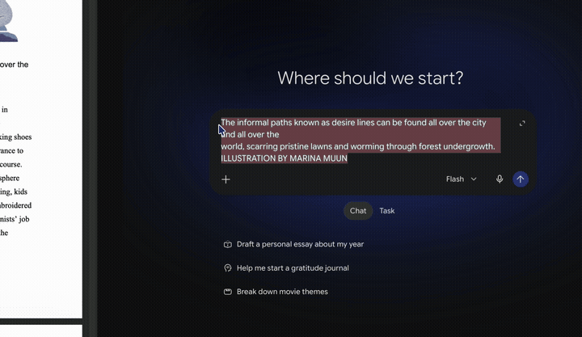

<p align="center">
  
</p>

<p align="center">
  
</p>

<p align="center">
  <strong>A temporary floating shelf for macOS screenshots. No desktop clutter, ever.</strong>
</p>

<p align="center">
  <a href="https://apple.com/macos"></a>
  <a href="https://swift.org"></a>
  
  
  
  <a href="LICENSE"></a>
</p>

---

## Demo

<p align="center">
  <a href="assets/demo.mp4">
    
  </a>
</p>
<p align="center">
  <sub>Hit <code>⌘⇧4</code> &rarr; floating stack &rarr; 1-click OCR &rarr; auto-redact secrets &rarr; scan QR &rarr; copy 1x downscaled &rarr; drag into Slack &rarr; auto-collapses when idle.</sub><br>
  <sub>(Full 60fps HD video: <a href="assets/demo.mp4"><code>assets/demo.mp4</code></a>)</sub>
</p>

---

## Why Osoko?

Most screenshots are temporary: you take one quickly to drop into Slack, paste into a PR or chat, or copy a line of text, and you never need the file again.

By default, macOS saves every capture directly to your Desktop, creating constant clutter. Apple's built-in floating thumbnail only holds one capture at a time, disappears quickly, and gets in the way of clicks. Osoko replaces that with an ephemeral floating shelf.

---

## Features in Action

### Copy & Paste Image
<p align="center">
  <a href="assets/feature-copy-image.mp4">
    
  </a>
</p>

### Drag & Drop
<p align="center">
  <a href="assets/feature-drag.mp4">
    
  </a>
</p>

### Copy Text (OCR)
<p align="center">
  <a href="assets/feature-copy-text.mp4">
    
  </a>
</p>

### Pin to Screen
<p align="center">
  <a href="assets/feature-pin.mp4">
    
  </a>
</p>

### Native Share
<p align="center">
  <a href="assets/feature-share.mp4">
    
  </a>
</p>

### More Superpowers
* **Privacy Shield (Auto-Redact):** Tap `R` to automatically black out detected API keys, credentials, and emails with solid black bars.
* **Smart QR & Barcode Detection:** Tap `L` to open or copy QR links recognized on screen.
* **Auto-Collapse Shelf:** Automatically tucks off-screen when idle after 10 seconds so it never blocks clicks.
* **Desktop Stays Clean:** `⌘⇧4` and `⌘⇧5` captures route straight into the floating stack instead of saving files to your desktop.

---

## Installation

### Method 1: Homebrew Cask (Recommended)

Installing via Homebrew is the easiest method—it automatically handles macOS Gatekeeper permissions so you can open the app without terminal commands or warnings:

```bash
# Add the tap and install Osoko
brew install ivanchiew/tap/osoko
```

---

### Method 2: Direct Download (DMG)

1. Download **`Osoko.dmg`** from the [Latest Releases](https://github.com/ivanchiew/osoko/releases).
2. Open the DMG and drag **Osoko** into your **Applications** folder:

<p align="center">
  <!-- Place your DMG drag-to-Applications screenshot here: assets/install-dmg.png -->
  
</p>

3. **First Launch Gatekeeper Notice:**  
   Because community release builds are built from open source without a commercial Apple Developer ID, macOS Gatekeeper may display a prompt stating the app cannot be verified.

   **To approve it in 5 seconds:**
   * **Option A (GUI):** Right-click (or Control-click) `Osoko.app` in `/Applications` &rarr; click **Open** &rarr; click **Open Anyway**.
   * **Option B (Terminal 1-liner):** Run this once to clear the download quarantine flag:
     ```bash
     xattr -cr /Applications/Osoko.app
     ```

---

## First-Time Setup & Permissions Walkthrough

When you launch Osoko for the first time, you will see the **Setup Wizard**. Osoko runs 100% locally on your Mac with zero telemetry, but needs standard macOS permissions to capture snippets and listen to hotkeys:

<p align="center">
  <!-- Place your Onboarding Wizard screenshot here: assets/onboarding-wizard.png -->
  
</p>

### Step 1: Screen Recording
* **Why it's needed:** Allows Osoko to capture interactive selection snippets (`⌘⇧4`) and active windows.
* **How to enable:**
  1. Click **Grant Access** in the wizard.
  2. macOS will open **System Settings &rarr; Privacy & Security &rarr; Screen Recording**.
  3. Toggle **Osoko** to **ON**.
  4. macOS will ask to restart the app. Click **Restart Osoko Now** in the wizard.

<p align="center">
  <!-- Place your Screen Recording setting screenshot here: assets/permission-screen.png -->
  
</p>

### Step 2: Accessibility
* **Why it's needed:** Enables single-key hover shortcuts (`1`, `2`, `T`, `R`, `L`, `Space`, `⌫`) and the `⌥⌘S` window snip hotkey.
* **How to enable:**
  1. Click **Grant Access** in the wizard.
  2. In **System Settings &rarr; Privacy & Security &rarr; Accessibility**, toggle **Osoko** to **ON**.

<p align="center">
  <!-- Place your Accessibility setting screenshot here: assets/permission-accessibility.png -->
  
</p>

### Step 3: You're Ready!
Hit **`⌘⇧4`** to take your first capture. The screenshot immediately slides into your floating corner stack, ready to be copied, redacted, or dragged anywhere!

---

## Shortcuts

### Global Capture Shortcuts
Osoko intercepts the macOS screenshot daemon cleanly:

| Shortcut | Action |
| :--- | :--- |
| `⌘ ⇧ 4` | **Selection Snip** (routes directly into Osoko stack) |
| `⌘ ⇧ 5` | **macOS Capture Utility** (selection, window, or display) |
| `⌥ ⌘ S` | **Window Snip** (interactive single-window capture) |
| `⌘ ,` | **Preferences / Settings** |

### Single-Key Hover Shortcuts
Hover your mouse over any card in the stack to trigger instant actions without clicking:

| Key | Action | Toast Feedback |
| :---: | :--- | :--- |
| **`1`** | Copy 1x Downscaled (Slack / GitHub) | *Copied 1x ✓* |
| **`2`** or **`C`** | Copy Original 2x (Retina) | *Copied ✓* |
| **`T`** | Copy Text (OCR) | *Text Copied ✓* |
| **`R`** | Redact Sensitive Data (API keys, emails) | *Redacted (n) ✓* |
| **`L`** | Open / Copy QR Code Link | *Opening Link...* |
| **`S`** | Save to configured folder (`⇧S` for Save As) | *Saved ✓* |
| **`P`** | Toggle Pin (keep on stack) | *Pinned* |
| **`Space`** | Open in Preview | — |
| **`⌫`** | Delete / dismiss card from stack | — |

---

## Settings & Customization

Open settings by:
- Right-clicking any screenshot card &rarr; **Settings...** (`⌘,`)
- Launching Osoko from Spotlight or Raycast while it's already running

### Actions & Toolbar Tab
Customize which 4 buttons appear on each card's hover bar:
* **Top-Right Slot 1 & 2:** Choose between Save, Pin, Copy 1x, OCR, Redact, Share, or **None (Hidden)**.
* **Bottom-Right Slot 1 & 2:** Modular quick-action slots.
* **Single / Double Click Gestures:** Choose what clicking the body of a card does (e.g. single-click to copy 1x, double-click to open in Preview).

<p align="center">
  <!-- Place your Settings Actions tab screenshot here: assets/settings-actions.png -->
  
</p>

---

## Support & Pricing (Open Source + Paid Pre-built)

**Osoko is 100% open source under the MIT License.**  
All processing—OCR, QR detection, downscaling, and redaction—runs strictly on-device with zero telemetry and zero network calls.

You have two ways to get Osoko:

1. **Free / Build from Source / Homebrew:** You can install free via Homebrew or compile with Swift PM:
   ```bash
   brew install ivanchiew/tap/osoko
   ```
2. **Pre-built DMG ($4.99):** If you prefer a pre-built, notarized application bundle that runs out-of-the-box and want to support ongoing maintenance against new macOS releases, you can purchase it for **$4.99** on [Gumroad](https://gumroad.com) to support development.

---

## Build from Source

### Requirements
- macOS 14.0 (Sonoma) or newer
- Swift 6.0+ / Xcode 15+

### Build Distributable App (DMG & ZIP)
Run the release packaging script:

```bash
./scripts/package.sh
```

This compiles a release build, signs the bundle, and outputs:
- **`dist/Osoko.app`**
- **`dist/Osoko.dmg`** (Drag-to-Applications disk image)
- **`dist/Osoko.zip`**

To run locally:
```bash
cp -R dist/Osoko.app /Applications/
open /Applications/Osoko.app
```

---

## License

MIT License. Open source and free to use.
